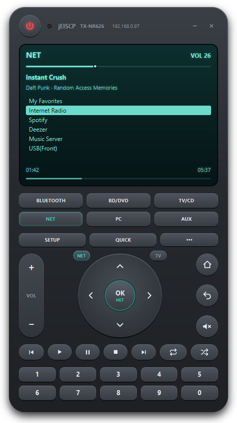
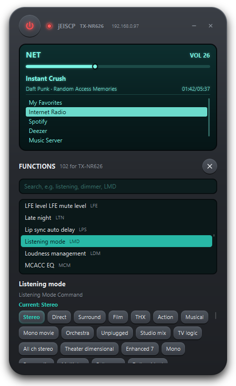
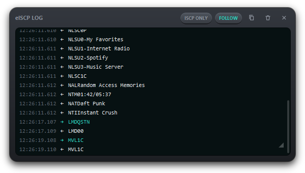
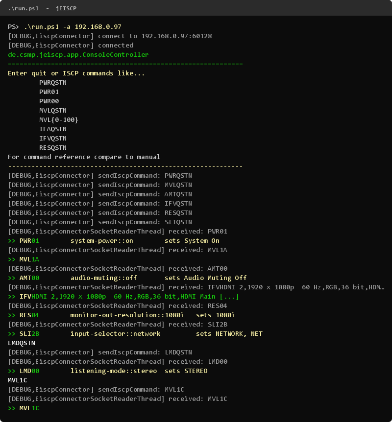

jEISCP
======

jEISCP is a Java implementation of the eISCP protocol used by network-enabled Onkyo/Integra AV receivers (and other devices, but the focus here is on AV receivers). It controls power, volume, input selection, network services and more, through a remote-control style JavaFX GUI and an ISCP console.

_ISCP_ (Integra Serial Control Protocol) is the message format for serial connections to the devices. _eISCP_ (ISCP over Ethernet) is its TCP/IP encapsulation, used for LAN and WLAN (default port 60128). Both are described in a technical documentation maintained by Onkyo (search for "onkyo iscp technical documentation").

Screenshots
===========

  
  

Usage
=====
You can use the source code "as it is" at your own risk. I'll not be responsible for any damage to your devices or computer.

You need Java 21 and a working [Maven] installation. Check out the repository together with its submodule:

    git clone https://github.com/cljk/jEISCP.git
    cd jEISCP
    git submodule update --init

Start it with

    .\run.ps1

on Windows (if script execution is blocked: `powershell -ExecutionPolicy Bypass -File run.ps1`) or

    ./run.sh

on Linux/macOS.

The scripts check for Java 21 and Maven and fetch a missing submodule. The JDK from `JAVA_HOME` is used for build and run; without `JAVA_HOME`, the one on the PATH is used. Maven only builds the project and pulls JavaFX from Maven Central; Java then runs directly in your terminal, so Ctrl+C ends the application.

All arguments are passed to the application:

| Argument | |
|---|---|
| `-a <ip-address>` | connect to this receiver, no autodiscovery |
| `-nogui` | console only |
| `-noconsole` | GUI only |
| `-?` | parameter help (`./run.sh -?`; in PowerShell `Get-Help .\run.ps1`) |

Without `-a`, the autodiscovery broadcasts on every network interface and repeats the query every second. If no receiver answers within 30 seconds, it gives up with a hint. In that case, make sure the receiver is on or has network standby enabled, or connect directly:

    .\run.ps1 -a 192.168.0.97

Remote control
--------------
The GUI looks like a remote control in a borderless window: drag it to move it; the keys at its top right minimize or quit.

* **Display:** input, volume (drag the bar), title, artist, album and time, the NET/USB list with its cursor, and cover art. Messages of NET services, such as a TuneIn connection error, appear here too; a click, OK or Return closes them.
* **Keys:** power, inputs, volume rocker and mute, playback, number keys, and SETUP / QUICK, which open the receiver's menus on the TV.
* **Direction pad:** the small NET and TV keys at its top corners decide what it controls: the NET/USB lists or the receiver's menus on the TV. The OK key shows the current target; it follows the input until you switch it.
* **"⋯" key:** all functions the connected model supports according to the command catalogue, e.g. listening mode, dimmer or late night. They are searchable and show their current value.
* **Header:** the receiver's model and IP address. Clicking the address opens the receiver's web interface, e.g. http://192.168.0.97/.
* **LED:** blinks with every command sent. Clicking it (or pressing L) opens the log window. It shows the complete log live, with commands sent (→) and received (←) highlighted, and can be filtered to ISCP traffic and copied.

Keyboard shortcuts: arrow keys, Enter and Backspace navigate; +/- change the volume; M mutes; L opens the log; digits are the number keys.

Console
-------
In the console you can enter ISCP commands, e.g. `MVL20` to set the volume or `PWRQSTN` to ask for the power state, and see the receiver's answers (marked with `>>`, with the command's description where the catalogue knows it). jEISCP adds the eISCP header and sends the message to the receiver. `quit` ends the application.

Development
-----------
`mvn test` runs the tests and writes a coverage report to `target/site/jacoco/index.html`. The network tests simulate the receiver on local sockets, so no device is needed. [AGENTS.md](AGENTS.md) describes the architecture and how the command constants are generated from the catalogue.

Status/Version
==============

2.0-SNAPSHOT

Tested with the TX-NR609 and the TX-NR626. Encoding and decoding of eISCP messages works, including autodiscovery. There is still work to do, e.g. selecting list entries directly in the display.

References
==========

For (e)ISCP compare the official documentation, which this project is mainly based on. There are also other projects on the topic:

* https://github.com/miracle2k/onkyo-eiscp (Python implementation with further references). Its YAML file of ISCP commands and receiver models is included as a submodule. jEISCP generates its command constants from it and reads command descriptions and model capabilities from it.

License
=======
Needs further thinking, but for now and until stated otherwise the source code is licensed under **[GPL v3]**.

  [maven]: https://maven.apache.org/
  [gpl v3]: https://www.gnu.org/licenses/gpl.html
